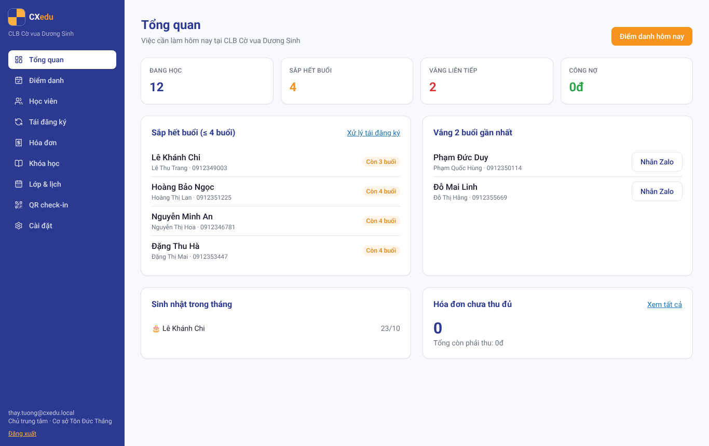
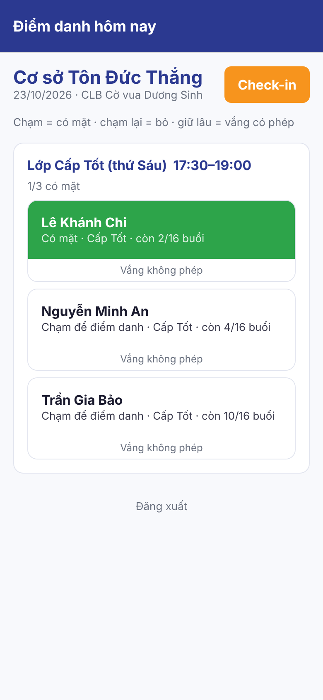
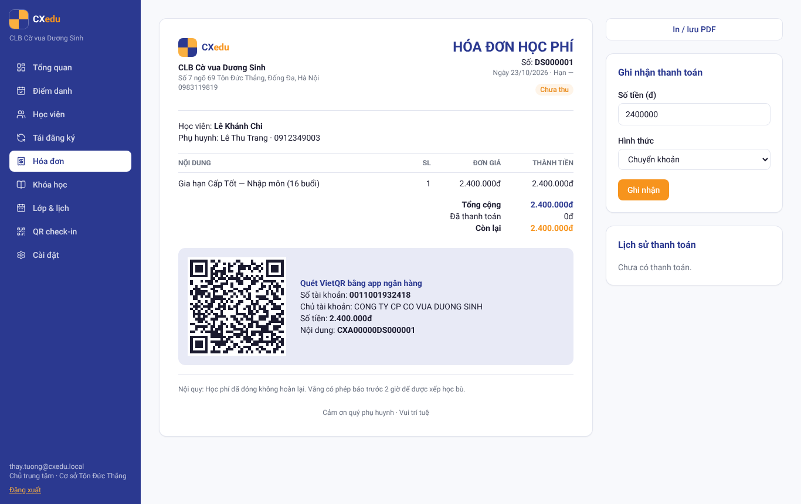

# CXedu — Hệ điều hành giữ chân học viên cho trung tâm cờ vua

CXedu giúp CLB và trung tâm cờ vua làm mấy việc chính: điểm danh 1 chạm, tự trừ buổi, báo học viên sắp hết buổi, gửi hóa đơn VietQR và theo dõi lộ trình 6 cấp **Tốt → Mã → Tượng → Xe → Hậu → Vua**.
Hệ thống chạy đồng bộ trên **web, desktop và mobile**. Sản phẩm của Công ty CP Cờ vua Dương Sinh · _Vui trí tuệ_.

| Web (Next.js 16)                                 | Mobile (Expo SDK 58)                                        | Hóa đơn VietQR                                      |
| ------------------------------------------------ | ----------------------------------------------------------- | --------------------------------------------------- |
|  |  |  |

## Kiến trúc

```
apps/web        Next.js 16 (App Router, Server Actions, Turbopack) + Tailwind v4 — web & cổng phụ huynh
apps/mobile     Expo SDK 58 + Expo Router (React Native 0.88) — giáo viên điểm danh, quét QR check-in
apps/desktop    Tauri 2 (Rust) — app lễ tân, cửa sổ kiosk QR toàn màn hình, thông báo hệ thống
packages/core   Nghiệp vụ thuần TypeScript: trừ buổi, cảnh báo, lịch dự kiến, VietQR, mã QR xoay 45s, lương GV
packages/api    Supabase client + TanStack Query hooks + Realtime dùng chung cho web/mobile
packages/db     Kiểu TypeScript sinh từ database
packages/ui-tokens  Màu, font, họa tiết bàn cờ theo nhận diện Dương Sinh
supabase/       Migrations Postgres 17, RLS đa trung tâm, RPC, pg_cron, seed, pgTAP tests
docs/plans/     Kế hoạch theo giai đoạn · docs/research/ khảo sát sản phẩm tham chiếu (REA)
```

Ba nền tảng dùng chung một backend Supabase. Khi một thiết bị điểm danh, Supabase Realtime đẩy thay đổi sang các thiết bị khác ngay lập tức. Test `apps/web/e2e/cross-platform-sync.spec.ts` kiểm tra đúng việc này.

Tooling theo repo [REA](https://github.com/covuaduongsinh/rea): pnpm + Turborepo, TypeScript 7, oxlint, oxfmt, Vitest 5, Husky.

## Chạy local

Yêu cầu: Node ≥ 22, pnpm 10, Docker (cho Supabase local); Rust + webkit2gtk nếu build desktop.

```bash
pnpm install
pnpm db:start                 # Supabase local: Postgres, Auth, REST, Realtime, Storage
pnpm db:reset                 # chạy migrations + dữ liệu mẫu CLB Dương Sinh
cp apps/web/.env.example apps/web/.env.local   # điền anon key từ `npx supabase status`
pnpm --filter @cxedu/web dev  # http://localhost:3000
```

Tài khoản mẫu (chỉ dùng local): `thay.tuong@cxedu.local` / `CXedu@2026` (chủ trung tâm), `gv.lan@cxedu.local` / `CXedu@2026` (giáo viên).

**Mobile:** `cp apps/mobile/.env.example apps/mobile/.env`, rồi `pnpm --filter @cxedu/mobile start`. Mở bằng Expo Go, hoặc development build nếu cần camera quét QR.

**Desktop:** `CXEDU_APP_URL=http://localhost:3000 pnpm --filter @cxedu/desktop dev`. Bản phát hành dùng `pnpm --filter @cxedu/desktop build`.

## Kiểm thử

```bash
pnpm check        # format + lint + typecheck + unit test (core, api)
pnpm db:test      # pgTAP: RLS đa tenant, trừ buổi, hóa đơn, cổng phụ huynh, check-in QR
pnpm e2e          # Playwright: luồng tái đăng ký + cổng phụ huynh (+ đồng bộ mobile↔web khi có E2E_MOBILE_URL)
pnpm --filter @cxedu/desktop check   # cargo check
```

## Lộ trình

Xem [docs/plans/2026-10-23-cxedu-master-plan.md](docs/plans/2026-10-23-cxedu-master-plan.md) và [docs/plans/2026-10-23-phase-3-6-roadmap.md](docs/plans/2026-10-23-phase-3-6-roadmap.md).
